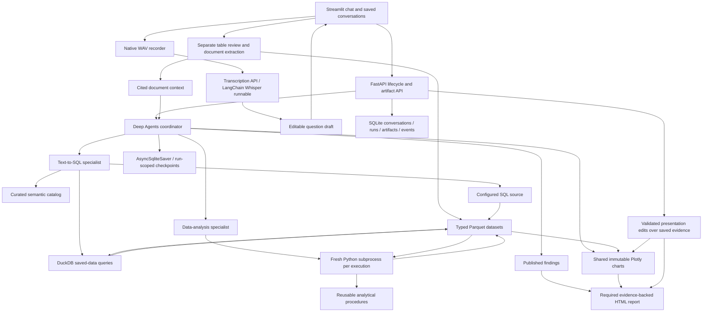

# Architecture

## Responsibilities and persistence

The coordinator routes by required work, not surface keywords. It handles
metadata-only discussion directly. SQL owns warehouse access and descriptive
transformations; Python owns analysis over explicit saved artifacts. Python can
request more data through the coordinator, which makes a sequential SQL
assignment and resumes the analysis. There are no fixed one-delegation rules.
The same coordinator and two specialists serve the expanded analytical methods;
each method is an ordinary Python procedure rather than another agent.

`datasets.py` handles bounded extraction, typed Parquet and full-artifact
summaries. `stores.py` handles conversation/run/analysis/report state using
`persistence.py`. Durable metadata uses typed JSON, with large content in files.
`execution.py` and the Python runner manage local cancellation. `run_manager.py`
owns execution/resume/stop/report retry; `approvals.py` translates exact edits;
`diagnostics.py` aggregates provider usage and bounded tool events.

The graph is constructed per configured source and uses one run ID as its
checkpoint identity. FastAPI opens/closes the maintained SQLite checkpoint saver.
On startup, unfinished computations become paused and pending reviews remain
reviewable. Each tool registers artifacts directly and journals its committed
output under run/assignment/tool-call identity for specialist work. Final assembly resolves explicit references;
it does not scan backward through messages or guess embedded JSON schemas.

## Reusable analytical procedures

`analysis/` supplies small pandas procedures that return named DataFrames for
`output_datasets`. The existing execution, review, lineage, chart and reporting
paths save and publish these results. The analyst chooses and inspects the
procedure through the analysis skill; no algorithm registry or new workflow
engine is involved. The seven delivered families are:

| Family | Procedure and evidence |
|---|---|
| Exploration and preparation | Full-population profiles, numeric/categorical distributions, pairwise correlations with sample counts, declared-date coverage and explicit conversion, fill, derived-column, drop and deduplication operations with an audit |
| Comparison and diagnostics | Descriptive group comparisons, keyed reconciliation and additive change contributions; unmatched groups and missing measures remain visible |
| Customer journeys | Retention over declared cohorts, ordered fixed-window funnels with right censoring, and deterministic RFM scores with segment profiles |
| Statistical comparison | Independent-group Welch mean differences and Hedges' g, or binary risk differences with Newcombe intervals and Fisher tests; sample/exclusion counts and undefined outcomes are saved |
| Prediction | Fixed Ridge regression or binary logistic pipelines with training-only preprocessing, declared random/time/group splits, simple baselines, held-out scores and scored rows |
| Time series | Explicit-frequency trend/STL diagnostics and residual anomaly flags; chronological ETS forecast evaluation followed by a final refit, with saved baseline/candidate predictions and declared model-based intervals |
| Scenarios | Cartesian grids of explicit scalar assumptions and a caller-supplied formula; undefined calculations are retained, and ranges have no assigned probability coverage |

Methods require task-specific choices rather than inferring business meaning
from column names. They preserve population/exclusion or censoring evidence and
unknown units. Reconciliation requires inputs at the same declared grain; additive
contributions are not causal explanations. Group inference assumes independent
observations and does not identify a causal effect. Prediction requires a declared
account of feature availability; split checks cannot detect every leakage path.
Time-series helpers require prepared calendar series and never infer a source
cutoff from first/last transactions. These are implemented procedures with local
numerical checks, not provider accuracy or user-study results.

## Analytical completion

Every Python execution declares general or forecast intent. Forecast intent stays
attached to the assignment across general checks and restart. Completion selects
final_outputs by execution ID/name and final_result_ids from successful assignment
outputs. A declared forecast needs selected saved predictions and validated
evaluation before completion; otherwise it remains partial. Full execution history
is retained, but synthesis, UI diagnostics and reports use final output selections.
Material dataset references are distinct from transitive supporting lineage.

Native call counters remain intact after exhaustion. The durable run marker blocks
further computation/delegation, forces partial publication and enables a bounded
coordinator allowance of eight model calls and sixteen tool calls for presentation,
within the separate time budget. In-flight work remains bounded by existing worker
limits. A failed presentation retains saved evidence and its report-retry path.

## Findings, reports, and recovery

`evidence.py` provides the shared scoped resolver for publication and reports,
including transitive dataset lineage.
Chart versions are immutable. Chat and report consume the same chart spec and
presentation dataset. Report metric values reference exact stored rows/columns.
A published answer remains visible if rendering fails; successful completion
requires its report. The coordinator selects and publishes findings once.
`ReportCompletionMiddleware` ends the graph after successful report attachment;
the run manager finishes from stored findings without requesting a duplicate
model-authored final answer. Metadata-only responses still use ToolStrategy.
Report blocks may arrange only published evidence, and omitted published charts
and analyses are attached automatically. Retry report reuses a valid
attached artifact, renders the saved specification, or requests presentation-only
repair using published findings. Computation tools reject execution after publication.
Resume selects this same recovery path after publication; active workers prevent
overlapping attempts.

## Direct presentation edits

`presentation_edits.py` handles `POST /api/runs/{run_id}/presentation` without
constructing agents or opening sources. Its typed allowlist admits title, labels,
palette, and compatible chart-type edits; scope and dataset bindings cannot be
edited. The caller supplies the displayed report/chart IDs. Stale IDs and active
conversations are rejected. Shape/data validation precedes candidate creation.
Sampled display datasets cannot change chart type.

The existing renderer renders a revision of the agent-authored report specification.
Original analytical turns, charts and reports remain immutable. Candidate records
in `presentation_edits` retain preparing/failed/ready status. A single atomic
`presentation_views` metadata write commits the new chart/report pair only after
both artifacts exist. Conversation and run reads resolve that view, including
history supplied to later analytical turns. Rendering failure leaves the previous
view intact; resubmitting the explicit edit retries it. History deletion includes
these records and their report files. No new graph run or provider call is needed.

## Chart intervals

Chart bounds require `interval` metadata: kind, method, optional label, and
optional nominal coverage. Scenario/sensitivity ranges cannot declare coverage.
The shared renderer displays the same label/method in chat and HTML; declaring
nominal coverage does not certify empirical calibration. This strict contract
does not migrate old bound specifications that omitted interval meaning.

## UI lifecycle and deployment constraints

Streamlit refreshes active content using a timed fragment, preserving stable
widget keys. Immutable previews/reports are cached by ID with bounded caches.
Full downloads stream separately from preview pages. Conversation changes cause
an app rerun; ordinary active-run refresh does not rebuild the conversation.

Constraints: one process, one local user, one warehouse or isolated file workspace
per conversation, sequential source queries. A file workspace may contain multiple
separately reviewed tables; warehouse conversations may attach documents as context
but cannot enrich warehouse data with uploaded tables. No persistent arbitrary
Python object state, cross-conversation learning, or obsolete in-memory-state migration.

## Semantic context

`semantic_context.py` builds one coherent metadata package for prompts and the
context tool. SQL owns physical definitions; the coordinator sees the business
projection. Whole oversized packages request refinement. Caches contain metadata,
never source observations. SQL/chart operational guidance lives in owner prompts;
analysis and report methodology remain on-demand skills.

## Corrections and clarification

`steering.py` uses supported before-model and after-model middleware plus tool
wrappers. Agent-private checkpoint state tracks correction IDs independently in
each assignment. Ordered HumanMessages have stable IDs, making checkpoint replay
idempotent. Later specialists receive the same durable corrections in their own
context. Tool wrappers reject stale proposed steps; running steps may finish.
Publication and completion share the run-store lock with acceptance and refuse
pending coordinator corrections. No concurrent invoke or graph-internal mutation
is used. Clarifications use interrupt/resume and remain distinct from code review.

The UI has one Activity disclosure per run, retained across publication and
completion. Incremental event cursors avoid retransmitting history each second;
hidden activity/diagnostics are rendered lazily. Findings remain visible while
reporting runs, fails or is retried. The composer remains outside the polling
fragment so typing and focus persist.

## Reviewed file workspaces and document context

`uploads.py` stages bounded CSV/Parquet/Excel tables in an isolated file conversation
and requires explicit schema confirmation for each table before analytical use.
The chat **+** button creates a file conversation or appends another table to the
current file workspace. CSV first enters Arrow as
text; Parquet retains supported scalar types. `excel.py` uses read-only `openpyxl`
to inspect `.xlsx` worksheets and normalize one explicit header/table range through
the same Arrow/Parquet review path. Range and formula-cache choices are saved;
each additional worksheet table must be imported and reviewed separately. Formula
recalculation is unsupported. Type suggestions and review checks
use the full bounded population. Confirmation creates an immutable reviewed
Parquet child, retains original bytes and snapshot, and saves SHA-256, selected
types, declared grain and verified row keys. Unsupported nested types, invalid
casts, duplicate declared keys and oversized files fail without truncation.

All reviewed tables in a file workspace share its source identity. Saved-data SQL
may combine named tables after resolving keys, grain and population meaning; a
matching column name does not establish a relationship. Uploads remain source-scoped
evidence, not entries in the shared warehouse registry
or generated OSI catalogs. Coordinator and SQL specialist use the same harness
with reviewed file context, omitting warehouse/semantic tools. SQL binds saved
artifacts into the existing external-access-disabled DuckDB query path; Python
uses the same saved-input execution tools. Charts and reports retain the existing
parent lineage. Reports include upload provenance. Warehouse agents keep their
curated semantic catalog requirements.

`POST /api/uploads/workbook` inspects workbook bytes before creating a conversation.
`POST /api/uploads?filename=...` accepts raw file bytes and creates the staged
conversation, or appends a table when its file-workspace `thread_id` is supplied.
`GET /api/conversations/{id}/uploads` lists its table records.
`GET /api/conversations/{id}/uploads/{upload_id}` returns at most ten preview rows
and review metadata; `POST /api/conversations/{id}/uploads/{upload_id}/confirm`
commits that table's explicit types/grain/keys. `GET /api/conversations/{id}/source` resolves that isolated
source. Upload sources never appear in the reusable source listing. Imports and
confirmation run off the event loop; history deletion refuses active imports or
reviews. Restart reopens staged or confirmed files. Source-configuration errors
are separate from model readiness so files work without a warehouse registry.

Excel staging also requires `sheet`, `cell_range` and, when applicable, explicit
`use_cached_formulas` acceptance. Cached formula freshness is unknown. Original
bytes/hash, selected range, warnings, types and keys remain visible on reopening
and in report provenance.

`documents.py` accepts readable PDF, UTF-8 text and Markdown in a new conversation
or as context attached to an existing one. Extraction runs in a bounded local
subprocess and retains original bytes/hash, parsed pages and candidate tables.
The coordinator's `list_documents`, `search_documents` and `read_document` tools
return bounded excerpts with document/page/line references. Document text is
unreviewed context, never instructions or accepted metric semantics. Scanned PDFs
require OCR before intake; no OCR or general repository/browser tooling is added.

`POST /api/documents` stages documents; conversation-scoped list, inspect and
download endpoints expose their provenance. Selecting a candidate PDF or Markdown
table stages a separate upload through the existing schema-review path. Numerical
use waits for confirmation. Warehouse conversations allow context documents only;
their extracted tables cannot become a second analytical source. Published document
references appear in reports and analysis exports, while reviewed table provenance
retains its document/page/table origin. General warehouse discovery, arbitrary
workspace code authoring and cross-source federation remain outside this expansion.

## Plans and concurrent analysis assignments

The coordinator explicitly installs LangChain's `TodoListMiddleware`; the current
Deep Agents base harness does not automatically expose `write_todos`. Complex
requests record public work steps before delegation. Parallel task batches without
a plan receive a tool correction. The UI renders the latest successful coordinator
plan and meaningful work events above the collapsed diagnostic Activity panel.
Plans are public task lists, not private model reasoning. Callback invocation IDs
separate concurrent operations even when model-supplied tool-call IDs repeat.
Human-review interrupts and cancellation have waiting/stopped activity states.

`DelegationMiddleware` wraps native task calls with bounded analysis slots and one
source slot. It preserves native checkpoint and interrupt handling. Async slot
acquisition is cancellation-safe; queued work checks Stop before starting. The
coordinator owns its context fields, so subagents cannot write conflicting copies
back when they finish together. `AssignmentMiddleware` creates a private,
checkpointed assignment ID in each SQL or Python branch. Tool commit keys include
it. Each branch persists its own application-owned receipt in the existing run
record. SQL's structured response contains answer and assumptions only; code attaches the
saved datasets, including inspected/reused snapshots and multiple query results.
Python's finish tool automatically attaches its own executions and inputs, saves
a compact receipt, and returns that receipt through graph state without a final
model-written copy. A validation failure stays in the specialist repair loop.
Separate branches cannot consume each other's unfinished executions or collide on
replay. New corrections invalidate a completed assignment receipt until reconciled.
Pending approval interrupts remain separate.

Investigation notes contain analytical context, not repeated artifact inventories.
A new turn includes unfinished prior-run objectives and committed receipts, chart
references, and execution summaries even if publication never happened. Exact
code and logs remain in stored evidence/inspection panels. Dataset, analysis and
chart discovery tools recover valid scoped references; invalid model selections
produce correction feedback rather than aborting the run. Scope validation remains
mandatory. Available artifacts are not automatically selected for publication.

The composer uses native `st.chat_input` attachments as the sole upload entry.
Tables join the current file workspace; documents join either source type. A table
attached in an established warehouse conversation offers a separate file conversation.
An optional table question waits in UI session state until schema confirmation,
then is consumed once. A document question proceeds in the current conversation.
Reloading does not replay the question. The composer keeps a stable configuration
through active work and completion so drafts survive polling. An attachment
submitted during active work receives feedback to finish or stop that work first;
text and voice corrections remain available.

## Model-authored choices and application-owned responses

`SQLAnalysisResponse` contains `answer` and `assumptions`. `CoordinatorResponse`
contains `answer`, `assumptions`, ordered `result_ids`, `analysis_ids`, `chart_ids`,
`partial`, and `unresolved_questions`. Interpretation belongs in `answer` rather
than a duplicate narrative field. Evidence resolution derives the primary dataset
from the ordered material selection and final analytical datasets. Transitive
lineage, exact SQL and full execution attempts remain supporting provenance. Selection remains model-authored:
not every retrieved diagnostic dataset belongs in the published answer.

`ChartRequest` contains chart choices and `previous_chart_id` for revisions.
`ChartSpec` adds application-owned `chart_id`, `source_result_id`, and `version`.
Run state, diagnostics, approval details, execution profiles, and persistence
records are internal/application contracts, not model-generated final responses.
The obsolete, unused `ReportBrief` contract has been removed.

API contract **22** exposes all actions in an interrupt as one ordered review,
including all named Python inputs. The UI submits one decision per action together
with the current interrupt ID; missing and stale decisions are rejected. Different
worker interrupts remain separate. One common form replaces the old SQL/Python
forms, and unused stored review-type state is removed. Saved-evidence comparisons and compact responses
remain implemented. Both processes must run the same version. There is
no old-record migration or compatibility reader; use a separate storage directory
for a new-contract workspace when retaining old history. Existing storage is not
deleted or modified by this code change.

## Conversational follow-ups and saved evidence

`AnalyticalMessageRequest` carries the question and optional previous_report_id
for ordinary report revisions. Correction and clarification remain separate
requests. Dataset listing, inspection and downloads preserve conversation/source
isolation. Agents can reuse suitable named saved results or retrieve current
warehouse data when the question requires it. Filters and business populations are
specified conversationally. There is no application-level input selector, population
filter, source-expansion flag or warehouse-refresh endpoint.

Saved SQL retains alias-to-parent bindings as calculation provenance. Reports and
exports identify final evidence and its supporting lineage. File updates require
an explicit new attachment; earlier snapshots remain unchanged.

`ForecastEvaluationRequest` describes a named prediction dataset and chronological
evaluation windows, frequency, origin, horizon, baseline/candidate and interval.
`forecasting.py` validates typed, regular complete periods and recomputes a named
score dataset. The stored ForecastEvaluation carries counts, forecast start and
limitations. Chart interval_series binds a band to one series and forecast_start
marks the first future period. Chat and HTML always expose evaluation evidence;
method-code inspection remains necessary to assess leakage beyond chronology.

## Portable analysis

`exports.py` resolves the completed turn's selected report/evidence and necessary
successful Python producers, including earlier same-conversation steps. One export
preparation supplies the script and `nbformat` notebook, typed snapshots, saved
outputs, dependency versions, hashes, SQL provenance and exact current HTML.
Failed attempts and unrelated evidence are excluded from executable replay.

`GET /api/runs/{run_id}/download?report_id=...` builds a temporary ZIP without
model/source calls, rejects unfinished turns and stale report IDs, and cleans up
after download. Export preparation is protected against concurrent history deletion.
`export_replay.py` and a copy of the existing worker form the standalone replay
runtime; each step runs in a fresh local process with exact named bindings.
Dataset and scalar/table results are compared with saved evidence. SQL is a fixed
snapshot boundary; replay does not refresh sources or regenerate interpretations
and published business charts. There is no app notebook editor or persistent kernel.
New bundles use format **4** and include final analysis_selections, named input
lineage and forecast descriptors. Only necessary
final producers/dependencies enter replay. Application analytical helpers are captured
at execution time; bundles replay each step against its exact source snapshot in
`steps/libraries/`, rather than the currently installed application code. Material
documents are included with original hashes and parsed context. Forecast errors and measured coverage recompute
from immutable or replayed predictions in both script and notebook. Lineage datasets
are distinguished from the selected final results.
See [portable replay checks](testing.md#portable-replay) and the
[historical record](../reviews/README.md#earlier-implementation-checks) for their
limits.

## Voice input

Native Streamlit recording sends WAV bytes to `POST /api/transcriptions`. The
LangChain async runnable in `transcription.py` calls the provider audio endpoint,
returning only text. The UI inserts that text into the composer for review and
explicit submission. This path creates no analytics run and does not add audio
files to application storage. See [configuration](configuration.md#voice-dictation).

## Exact presentation revisions and KPI comparisons

`POST /api/runs/{run_id}/report-title` takes `report_id` and `title`. The current
report ID guards stale edits. The application copies its saved specification,
updates only the title/revision link, renders, then commits the presentation view.
It preserves the previous view on failure and survives restart. No model, SQL, or
Python execution is required. Conversational `revise_report_title` shares this
renderer and reuses published findings. `GET /api/reports/{report_id}/spec` exposes
the stored specification for auditing.

`ReportMetric.comparison` binds two rows of one complete saved aggregate. The
renderer calculates changes and reconciles periods, unique keys, dimension values,
unit labels, and optional rate numerators/denominators. SQL grounding stores exact
canonical output-column bindings in `SavedResult.metric_columns`; transparent CTE
projections retain them, arbitrary transformations do not assert them. The report
explicitly distinguishes verified from unverified metric binding. These checks
cannot prove source joins or a model-authored population description. Completeness
is currently always unknown. See the [report specification](../../skills/reporting/report-design/references/report-spec.md).
