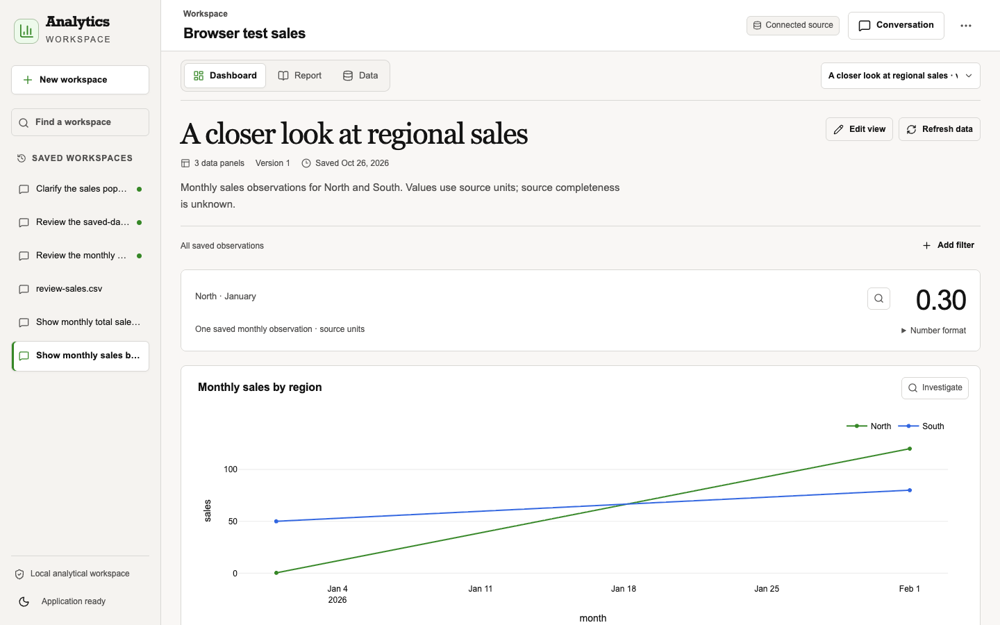

# GenBI and GenUI delivery review

26 October 2026. This review covers the local application. It uses repository evidence and the linked primary sources.

## Assessment

The original dashboard had a sound evidence model. It did not use several useful advances in agent interfaces.
Most changes still required a full agent run. The React client polled run details.
Chart selections had no exact data contract. Dashboard types had separate Python and TypeScript definitions.
The first visual design gave controls and process details too much space.

The best next step was to improve the existing product in layers.
Replacing the coordinator or evidence stores would add risk without a clear user benefit.
Protocol adoption alone would not improve analytical accuracy or visual quality.

The implementation now adds deterministic saved-data interactions, public run events, exact selections, and direct presentation edits.
It also adds a bounded A2UI export. It retains the coordinator, SQL specialist, Python specialist, and required HTML reports.

## Protocol decisions

| Capability | Useful pattern | Decision in this application |
|---|---|---|
| A2UI | Declarative components and a trusted application catalog | Export validated evidence references through a small v0.9.1 catalog. Keep numerical values in the existing evidence response. |
| AG-UI | Run lifecycle, public state, events, and interrupts | Use official event types for attachment to an existing run. Keep application-owned review and action endpoints. |
| CopilotKit | Headless React hooks and maintained agent interface components | Do not add another runtime. Reconsider the hooks when they remove more code than they add. |
| Structured UI generation | Generate a constrained view specification instead of arbitrary executable UI | Retain the existing typed DashboardSpec. Generate client types from the server response schema. |
| Direct manipulation | Let a reader change a known presentation or selection without another model call | Add metric formats, completed chart edits, multi-select filters, saved-domain search, and exact chart selections. |
| Progressive results | Show useful state while work continues | Observe public run events. Commit the next dashboard only after its evidence and report succeed. |

A2UI describes a user interface. AG-UI describes agent interaction events.
These protocols solve different problems. Neither defines metric meaning, data permissions, or correct calculations.
The application must retain these responsibilities.
See the [A2UI specification](https://a2ui.org/specification/v0.9.1-a2ui/) and
[AG-UI specification](https://docs.ag-ui.com/spec/1.0/events/lifecycle).

The AG-UI endpoint is an application GET attachment with replay.
It does not implement the standard POST run binding.
Closing or reconnecting the stream cannot start or stop an analytical run.
The [standard HTTP/SSE binding](https://docs.ag-ui.com/spec/1.0/basic/transports/http-sse)
does not itself provide resumable delivery.

The maintained A2UI React renderer was installed, inspected, and built in an integration experiment.
Its required dependency tree had unresolved security advisories. The runtime packages were then removed.
The local interface uses trusted React components. The A2UI server compiler remains tested and available.
The [protocol evaluation](genui-protocol-evaluation-2026-10-25.md) records versions, advisory details, and limits.

CopilotKit can reduce future interface work. It would also require a clear owner for execution, history, interrupts, and persistence.
The current application already owns those functions.
Production direct connections also need a review of the documented product terms.
See [self-managed agents](https://docs.copilotkit.ai/deepagents/backend/self-managed-agents) and
[runtime ownership](https://docs.copilotkit.ai/deepagents/backend/agent-runner).

## Implemented boundaries

Known filters can now use SQL-owned definitions over complete saved populations.
The compiler validates dimensions, measures, filter columns, types, and scope.
Driver parameters carry selected values. Saved receipts retain the definition, parameters, parent population, and execution identity.
Optional SQL review still shows the exact calculation.

A new metric, relationship, population, or analytical method still returns to the existing specialists.
Source refresh remains a governed analytical run.
Python-derived evidence does not enter the direct filter path without a supported execution definition.

Category search reads the complete saved domain. It does not call a preview complete.
Chart selections retain the saved result ID, field, and exact typed values.
The server checks membership before it accepts a selection.
A selected mark supplies investigation context. It does not silently change the analytical population.

Presentation edits use saved evidence. A metric-format edit renders the matching report before it commits the dashboard revision.
Failed rendering preserves the previous dashboard and report. Request records support retry and restart.
New formats require an explicit Python numeric type. An Excel-like pattern such as `0.00` is rejected.
This prevents the observed display of stored `138.6` as `1e+02`.

The public event stream contains selected state and fixed activity labels.
It excludes source rows, prompts, code, tool arguments, and graph state.
Detailed diagnostics remain in the existing inspection interface.

## Visual direction

Use an editorial analytical style with the existing warm background, dark text, and green accent.
Use clear type sizes, restrained borders, and consistent spacing.
Give the reader a clear sequence: title, key values, primary chart, supporting data, then evidence and limits.

The dashboard must lead with the result. The first screen must not be a wall of controls or activity logs.
Keep method notes concise and expandable. Keep filters compact when no filter is declared.
Keep the conversation easy to open. Give a saved dashboard enough width for its charts.

Use a small metric strip. Let the primary chart carry the main comparison or trend.
Do not add decorative charts, unsupported claims, invented units, or numerical summaries.
Keep exact values available when display rounding improves table readability.
Preserve explicit user layout choices.

## Recommended next layers

| Order | Change | Acceptance condition |
|---|---|---|
| 1 | Complete unavailable-value presentation | NULL aggregates show an explicit unavailable state in cards, charts, and reports. They never become zero. |
| 2 | Evaluate complete analytical tasks | Use independently known answers. Check method choice, scope, values, report agreement, and recovery separately. |
| 3 | Measure interaction performance | Measure filter completion, report creation, reconnect recovery, and first useful chart. Separate model time from local execution time. |
| 4 | Test the design with readers | Ask readers to find the main result, change a filter, inspect evidence, and explain uncertainty. Record task success and observed confusion. |
| 5 | Revisit the maintained A2UI renderer | Require a supported dependency tree, catalog conformance, action tests, revision checks, and desktop/mobile visual review. |
| 6 | Add broader UI generation only for a demonstrated task | Extend the trusted catalog with tested components. Retain saved evidence bindings and explicit allowed actions. |

Hosted sharing, scheduled work, collaborative editing, and additional agent runtimes need separate product requirements.
They are not prerequisites for a useful local GenBI workspace.

## Verification

The final backend regression run passed **773 tests**. Six opt-in provider tests were skipped.
The dependency lock check passed. The current frontend audit reports **zero known vulnerabilities**.
Ruff and whitespace checks passed for the reviewed code.

The tests cover scope, type identity, parameter receipts, review, stop/resume, replay, restart, report rollback, and stale writes.
They also cover exact chart selections, search, and portable SQL provenance.
No provider or production warehouse trial was run.
Scripted browser checks and synthetic data do not establish live-model accuracy or human usability.

The final browser build passed **36 scenarios**: 22 full workflows, nine design
checks, and five GenBI interaction checks. The full workflows include native
Streamlit. There were no unexpected browser exceptions or HTTP errors.
The interaction checks include a real chart-mark click and connection recovery
with one analytical run and one saved turn.
The separate deployment check also passed. An existing tab rendered its first
chart after the old build entry was removed, without another script request.

The focused visual check passed at desktop and phone widths.
At 1440 × 900, the title starts at 169 pixels, the metric strip at 389 pixels,
and the main chart at 526 pixels. The 375-pixel phone layout has no horizontal overflow.
Checks also cover exact-value keyboard access, metric/report agreement, preserved
explicit metric width, and visible required reviews.

The production frontend assets match the tested build. The saved user dashboard
was opened in the app and inspected after the format correction.
Its metric now displays `138.60`. Its stored value, dataset references, chart
references, and analytical run remain unchanged. The correction created dashboard
version 2 and a matching report revision.

Reproduce the local checks with the commands in the
[testing guide](../development/testing.md). The dated browser receipts and visual
captures accompany this review. No business-user study was performed.

- [Workflow receipt](evidence/genui-2026-10-26/workflows.json)
- [Design receipt](evidence/genui-2026-10-26/design.json)
- [Interaction receipt](evidence/genui-2026-10-26/interactions.json)
- [Visual receipt](evidence/genui-2026-10-26/visual.json)
- [Deployment receipt](evidence/genui-2026-10-26/deployment.json)
- [Phone preview](evidence/genui-2026-10-26/phone.png)
- [Dark preview](evidence/genui-2026-10-26/dark.png)

The preview uses synthetic test data.

